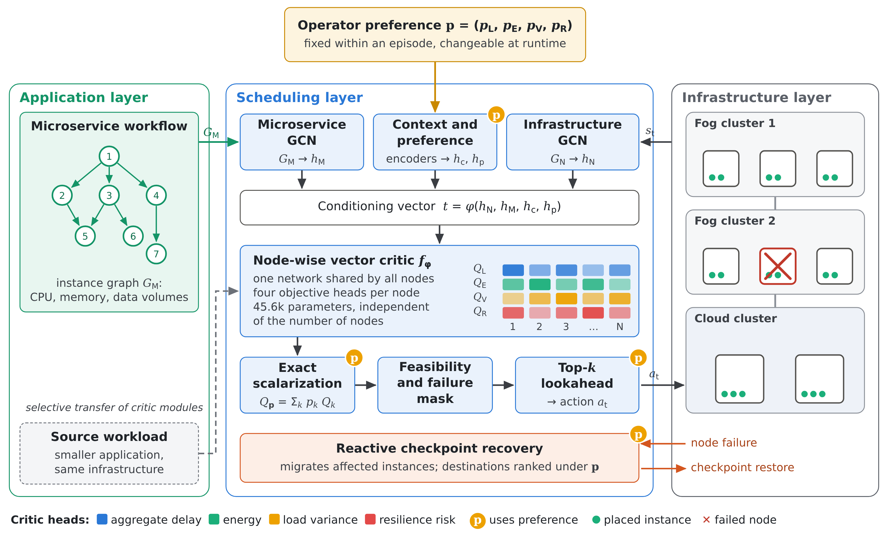
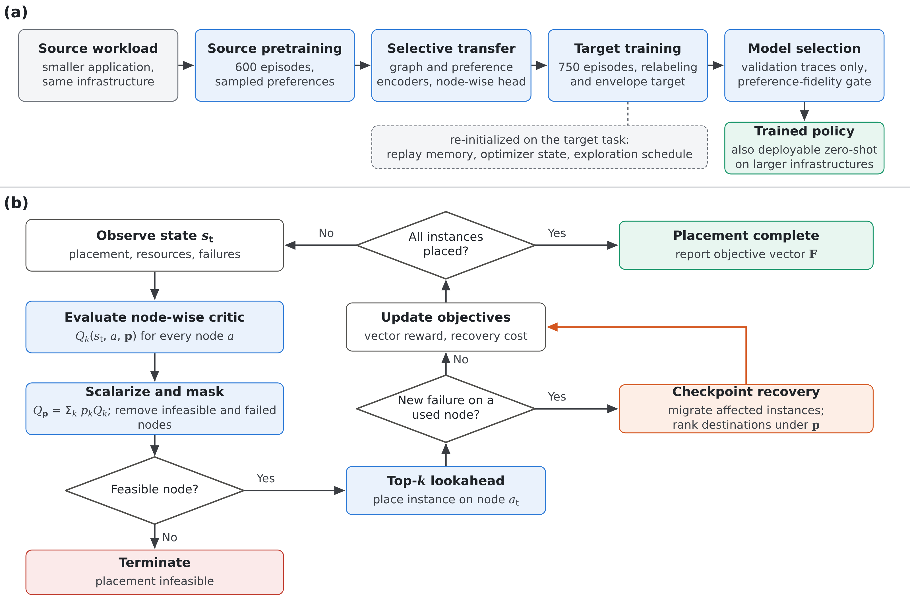

# TL-FT-Pareto-DRLA

**Preference-steerable and fault-tolerant deep reinforcement learning for multi-objective microservice placement in Hybrid Fog/Cloud environments**

This repository contains the simulator, the method, all baselines, and the scripts that reproduce every experiment, table, and figure of the paper.



TL-FT-Pareto-DRLA places the instances of a containerized microservice application, one at a time, on the nodes of a heterogeneous Fog/Cloud infrastructure. It optimizes four objectives:

- aggregate delay,
- modeled energy,
- load variance,
- resilience risk.

The method has the following components:

- **One policy for all trade-offs.** An operator preference **p** conditions a vector critic with four objective heads. **p** is kept unchanged through action selection, replay, and the Bellman target, so one trained policy can be steered at runtime.
- **Size-independent critic.** One network evaluates every candidate node, and the critic has 45.6k parameters for any number of nodes. A policy trained on 8 nodes can be deployed on 16 or 32 nodes without retraining.
- **Constraints and failures.** A hard feasibility and failure mask removes invalid nodes. A bounded checkpoint-based recovery migrates affected instances after a node failure and charges the restore delay and energy.
- **Sample efficiency.** Safe preference relabeling with an envelope target improves training. Selective transfer initializes the critic from a smaller source workload. A value-guided top-k lookahead adds one exact Bellman backup at decision time.



## Repository structure

```
├── tl_ft_pareto_drla.py    # simulator, method, baselines, statistics, figures, Excel report
├── run_experiments.py      # command-line entry point for the experiment suite (13 scenarios)
├── extra_experiments.py    # preference-conditioning ablation and zero-shot size transfer
├── data/                   # workload and infrastructure definitions (.xlsx)
├── docs/                   # figures used in this README
├── requirements.txt
├── CITATION.cff
└── LICENSE
```

## Installation

Python 3.9 or newer is required (tested with Python 3.13 on Linux and with Python on Windows). A GPU is not needed.

```bash
git clone https://github.com/<user>/<repository>.git
cd <repository>
python -m venv .venv
source .venv/bin/activate          # Windows: .venv\Scripts\activate
pip install -r requirements.txt
```

## Data

Each `.xlsx` file describes one application (microservices, instances, CPU/memory demand, communication volumes) and one Hybrid Fog/Cloud infrastructure (environments, clusters, nodes, capacities, bandwidths).

| File | Role |
|---|---|
| `hotelReservation-new.xlsx` | source workload: 8 microservices, 10 instances |
| `hotelReservation-new-16ms-50communications.xlsx` | target workload: 16 microservices, 20 instances, 50 communication relations |
| `hotelReservation-new-16ms-30communications.xlsx` | sparser communication graph (30 relations) |
| `hotelReservation-new-16ms-50communications-alt-topology.xlsx` | alternative cluster membership and link bandwidths |
| `bookinfo-new.xlsx` | second application (bookinfo) |

The original capacities are scaled by a capacity-pressure factor before training. The factor is 0.07 in the reference setting; other values are evaluated as separate scenarios.

## Quick start

A plumbing test runs in a few minutes. Its numbers are not meaningful.

```bash
python run_experiments.py --budget smoke --scenarios BASE_N8 --output results_smoke
```

## Reproducing the paper

### 1. Main experiment suite

The suite trains and evaluates every method in 13 scenarios, with 5 training seeds and 40 held-out failure traces per scenario:

| Group | Scenarios |
|---|---|
| reference | `BASE_N8`: 8 nodes, 20 instances, capacity factor 0.07 |
| workloads | `WL_BOOKINFO`, `WL_SPARSE30`, `WL_TOPOLOGY`, `WL_HEAVY` (demand ×1.5) |
| scalability | `SC_N16_HOM`, `SC_N16_HET`, `SC_N32_HOM`, `SC_N32_HET` (16/32 nodes, 40/80 instances, homogeneous or heterogeneous) |
| capacity pressure | `CP_0p05`, `CP_0p10`, `CP_0p15`, `CP_1p00` |

The compared methods are:

- TL-FT-Pareto-DRLA (proposed),
- No-TL,
- the uniform fixed-weight DQN specialist,
- Xu-MODRL-2026 (adapted),
- K8s+mask,
- greedy minimum-latency, greedy least-loaded, and random feasible placement.

The reference scenario additionally trains eight fixed-preference specialists and the component ablations.

You can run the suite in one process:

```bash
python run_experiments.py --budget paper --output results
```

Or you can run it as five independent parts in parallel. Use the same `--output` folder for every part; the five parts have been run together on a laptop with 8 GB of RAM:

```bash
python run_experiments.py --budget paper --output results --part A   # reference + workloads
python run_experiments.py --budget paper --output results --part B   # 16 nodes + capacity levels
python run_experiments.py --budget paper --output results --part C   # 32 nodes hom., seeds 1, 7, 21
python run_experiments.py --budget paper --output results --part D   # 32 nodes het., seeds 1, 7, 21
python run_experiments.py --budget paper --output results --part E   # 32 nodes, seeds 42, 100
```

To check progress and build the report:

```bash
python run_experiments.py --budget paper --output results --status
python run_experiments.py --budget paper --output results --report
```

The 32-node scenarios dominate the run time. On a 4-core laptop the five parallel parts take on the order of one to two weeks. Every finished training or evaluation unit is stored immediately, so you can stop a run at any time and start it again with the same command to continue.

### 2. Preference-conditioning ablation and zero-shot size transfer

These experiments reuse the checkpoints and test traces of the main suite. They write their results to `results/results_paper/extra_experiments/`.

```bash
python extra_experiments.py --output results --part A   # ablation of preference conditioning (BASE_N8)
python extra_experiments.py --output results --part B   # zero-shot 8 -> 16 nodes
python extra_experiments.py --output results --part C   # zero-shot 8 -> 32 nodes hom.
python extra_experiments.py --output results --part D   # zero-shot 8 -> 32 nodes het.
python extra_experiments.py --output results --report
```

## Outputs

```
results/results_paper/
├── report/results.xlsx       # all tables (one sheet each) + embedded figures
├── report/*.csv              # the same tables as CSV
├── plots/                    # figures (PNG)
├── raw/                      # per-seed, per-trace and per-preference results (JSON lines)
├── checkpoints/              # selected model of every training run
├── traces/                   # training / validation / test failure traces
└── extra_experiments/report/extra_results.xlsx
```

The main sheets of `results.xlsx` are the following:

- `Scalability`, `Workloads`, `Capacity_Sensitivity`: mean ± 95% CI per scenario and method.
- `Ranking`: ranking of the methods over the scenarios.
- `Stat_Tests`: paired sign-flip permutation tests over (seed, test trace) pairs, Holm-adjusted.
- `Steerability`: exact seed-blocked permutation test of the preference response.
- `Specialist_Gap`: one preference-conditioned policy versus nine fixed-preference specialists.
- `Ablation`: component ablations.
- `Fault_Cardinality`: k = 1–3 simultaneous node failures.
- `Scaling_Exponents`: training and inference cost versus the number of nodes.

## Budgets

| Budget | Target / source episodes | Seeds | Train / val / test traces | Purpose |
|---|---|---|---|---|
| `smoke` | 3 / 3 | 1, 2 | 4 / 4 / 4 | plumbing test |
| `pilot` | 200 / 150 | 1, 42, 100 | 16 / 8 / 16 | development (separate trace seeds) |
| `reduced` | 400 / 300 | 1, 42, 100 | 24 / 12 / 24 | quicker approximate run |
| `paper` | 750 / 600 | 1, 7, 21, 42, 100 | 40 / 20 / 40 | protocol of the paper |

All design decisions were fixed on the `pilot` budget. Its failure traces are disjoint from the test traces of the `paper` budget.

## Reproducibility notes

- Runs are seeded, and each process uses one PyTorch thread by default (`--threads`). Re-evaluating a saved checkpoint therefore reproduces the reported numbers exactly.
- Checkpoints are selected on validation traces only. The test traces are used only for the final evaluation.
- Internal method identifiers in the raw files are `full_v3` (proposed), `no_tl_v3`, `fixed_weight_uniform_v3`, `xu_modrl`, `k8s`, `greedy_latency`, `greedy_load`, and `random`.

## Authors

Farnaz Izadi, Reihaneh Khorsand, Mohammadreza Soltanaghaei, Navid Khaledian

## Citation

If you use this code, please cite the paper (see `CITATION.cff`):

```bibtex
@article{tlftparetodrla,
  title   = {Preference-Steerable and Fault-Tolerant Deep Reinforcement Learning for
             Multi-Objective Microservice Placement in Hybrid Fog/Cloud Environments},
  author  = {Izadi, Farnaz and Khorsand, Reihaneh and Soltanaghaei, Mohammadreza and Khaledian, Navid},
  journal = {Under review},
  year    = {2026}
}
```

## License

Released under the MIT License (see `LICENSE`). The workload files are derived from the hotelReservation application of DeathStarBench and from the bookinfo application. Please also cite the original benchmarks when you use them.
